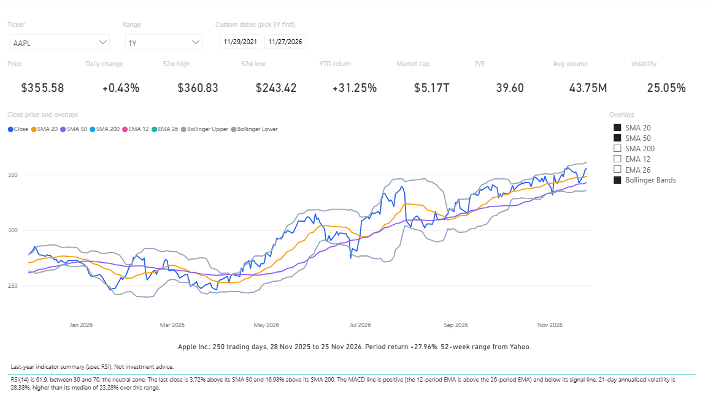

# Stock Market Dashboard

A stock market analytics project. Python fetches five years of daily prices
from Yahoo Finance, cleans them and calculates the technical indicators. A
Power BI report shows them as KPI cards and interactive charts across five
pages. The same Python code also writes a one-page PDF summary per ticker, a
walkthrough notebook and a project report.

No API keys are needed. Yahoo Finance data is free through `yfinance`.



## What it does:

1. **Fetch** daily open, high, low, close and volume (OHLCV), plus company
   details such as name, sector, market cap and P/E.
2. **Clean** the data: sort and de-duplicate dates, fill gaps inside the range,
   fix rows where the high is below the low.
3. **Calculate** the indicators with pandas: moving averages, RSI, MACD,
   Bollinger Bands, returns, volatility and drawdown.
4. **Export** `prices.csv` and `tickers.csv` for Power BI, and one PDF summary
   per ticker.
5. **Show** everything in Power BI, with slicers for ticker, date range, chart
   overlays and RSI formula.

The Power BI report has five pages:

| Page | Contents |
|---|---|
| Price & Overlays | KPI cards, close price with SMA, EMA and Bollinger overlays, written indicator summary |
| Candlestick & Volume | Daily open, high, low and close, volume bars with the 20-day average |
| RSI & MACD | RSI with the 70 and 30 lines, MACD with signal line and histogram |
| Compare Stocks | Several tickers rebased to 100 on their first common date |
| Returns Analysis | Monthly returns grid, correlation of daily returns, daily returns histogram |

## Install

You need Python (built and tested on 3.13) and, for the dashboard,
Power BI Desktop (free, Windows only). The PDF charts are drawn by `kaleido`,
which uses a local Chrome or Chromium.

```powershell
python -m venv .venv
.venv\Scripts\python.exe -m pip install -r requirements.txt
```

## Run

All commands run from the project folder.

**1. Write the data and the PDF summaries** (needs internet, about a minute):

```powershell
.venv\Scripts\python.exe -m src.export.powerbi_data
```

This writes `powerbi/data/prices.csv`, `powerbi/data/tickers.csv` and one PDF
per ticker in `reports/`. To use other tickers, name them after the command.
They replace the default five:

```powershell
.venv\Scripts\python.exe -m src.export.powerbi_data AAPL MSFT INFY.NS
```

Add `--no-pdf` to skip the PDFs.

**2. Open the dashboard.** Open `powerbi/StockDashboard.pbip` in Power BI
Desktop and click **Refresh**. On a new computer, first point the model at
your copy of the data: **Transform data > Edit parameters > DataFolder**, set
to the full path of the `powerbi\data` folder. More detail is in
[powerbi/README.md](powerbi/README.md).

**3. The walkthroughs** (optional). The script runs the whole flow and prints
what happens at each step. The figures and a one-page `dashboard.html` go to
`deliverables/walkthrough_output/`.

```powershell
.venv\Scripts\python.exe deliverables\walkthrough.py
```

The notebook [deliverables/walkthrough.ipynb](deliverables/walkthrough.ipynb)
holds the same steps with their output saved, so it can be read on GitHub
without running anything. Nothing rebuilds one from the other, so a change to
the script needs the same change in the notebook.

The project report,
[deliverables/Project_Report.pdf](deliverables/Project_Report.pdf), covers the
business case, the architecture, the flowchart and the results, with the
Power BI screenshots from `deliverables/screenshots/`.

**4. The checks.** Three scripts in `tests/` check the indicator maths against
the spec, the charts and the export. Each prints `ok` or `FAILED` for every
check and exits with an error if any fail. The parts that need live data are
skipped when offline.

```powershell
.venv\Scripts\python.exe tests\check_indicators.py
```

```powershell
.venv\Scripts\python.exe tests\check_charts.py
```

```powershell
.venv\Scripts\python.exe tests\check_export.py
```

## Project structure

```
Stock-Market-Dashboard/
├── powerbi/
│   ├── StockDashboard.pbip            # open this in Power BI Desktop
│   ├── StockDashboard.SemanticModel/  # tables, relationships, DAX measures
│   ├── StockDashboard.Report/         # the five report pages
│   ├── README.md                      # running and moving the report
│   └── data/                          # CSV files from the export (not in git)
├── src/
│   ├── config.py                      # tickers, indicator windows, colours
│   ├── formatting.py                  # money, percentages, missing values
│   ├── kpis.py                        # the KPI cards for the PDF
│   ├── data/
│   │   ├── fetcher.py                 # the only code that calls Yahoo Finance
│   │   └── cleaner.py                 # validation and tidying
│   ├── indicators/
│   │   ├── __init__.py                # enrich(): adds every indicator column
│   │   ├── moving_averages.py         # SMA, EMA
│   │   ├── rsi.py                     # RSI, spec and Wilder versions
│   │   ├── macd.py                    # MACD, signal line, histogram
│   │   ├── bollinger.py               # Bollinger Bands, %B, bandwidth
│   │   └── returns.py                 # returns, volatility, drawdown, monthly grid
│   ├── charts/                        # eight Plotly charts for the PDF and notebook
│   └── export/
│       ├── powerbi_data.py            # writes the CSV files and the PDFs
│       ├── pdf_report.py              # the one-page PDF summary
│       └── commentary.py              # the written indicator summary
├── deliverables/
│   ├── walkthrough.py                 # the whole flow as a script
│   ├── walkthrough.ipynb              # the same, as a notebook
│   ├── Project_Report.pdf             # the project report
│   └── screenshots/                   # Power BI pages used in the report
├── tests/
│   ├── check_indicators.py            # indicator maths against the spec
│   ├── check_charts.py                # the eight Plotly charts
│   └── check_export.py                # KPI cards, commentary and the PDF
├── reports/                           # PDF summaries from the export (not in git)
├── docs/journal/                      # build and error logs
├── SPEC.md                            # what the project had to do
├── IMPLEMENTATION_PLAN.md             # how it was built, phase by phase
└── requirements.txt
```

## Indicators

All are calculated from scratch with pandas and numpy, in `src/indicators/`.

| Indicator | Column | How it is calculated |
|---|---|---|
| Simple moving average | `SMA_20`, `SMA_50`, `SMA_200` | Mean of the last 20, 50 or 200 closes |
| Exponential moving average | `EMA_12`, `EMA_26` | Weighted mean that favours recent closes |
| RSI (14) | `RSI_14`, `RSI_14_WILDER` | `100 - 100 / (1 + average gain / average loss)`. Above 70 is read as overbought, below 30 as oversold |
| MACD | `MACD`, `MACD_SIGNAL`, `MACD_HIST` | EMA 12 minus EMA 26; signal is the 9-day EMA of that; histogram is the gap between them |
| Bollinger Bands | `BB_UPPER`, `BB_MIDDLE`, `BB_LOWER` | 20-day SMA plus and minus 2 standard deviations |
| Bollinger %B and bandwidth | `BB_PERCENT_B`, `BB_BANDWIDTH` | Where the close sits in the band, and how wide the band is |
| Daily return | `DAILY_RETURN` | `(close - previous close) / previous close` |
| Cumulative return | `CUM_RETURN` | Daily returns compounded from the first day |
| Drawdown | `DRAWDOWN` | Fall from the highest close so far |
| Volatility | `ROLL_VOL_21` | Standard deviation of daily returns over 21 days, times the square root of 252 (365 for crypto) |
| Volume average | `VOL_SMA_20` | Mean volume over 20 days |

Two notes on the choices made:

- **RSI comes in two versions.** The spec's formula uses plain 14-day
  averages. Trading platforms use Wilder's smoothing, which gives smoother,
  different numbers. Both are in the data and a slicer in Power BI switches
  between them. The spec's version is the default.
- **Correlation uses daily returns, not prices.** Two unrelated stocks that
  both rose over a year show a price correlation near 0.9 just from the shared
  trend. Returns show whether they move together day to day.

## Sample tickers

| Ticker | Name | Why it is included |
|---|---|---|
| AAPL | Apple | Well-known US stock with a clear trend |
| TSLA | Tesla | High volatility, good for RSI and Bollinger Bands |
| RELIANCE.NS | Reliance Industries | Indian market (NSE) |
| TCS.NS | Tata Consultancy Services | Indian IT |
| BTC-USD | Bitcoin | Crypto, which trades every day |

Indian stocks need the `.NS` suffix (`.BO` for BSE). Crypto pairs look like
`BTC-USD`.

## Known limits

- **Yahoo Finance is unofficial.** It can rate-limit, change its responses or
  be briefly unavailable. A ticker that fails is reported and skipped, and the
  others still load. All Yahoo calls are in `src/data/fetcher.py`, so a change
  there is a one-file fix.
- **Company details can be missing.** Yahoo sometimes returns nothing for
  market cap, P/E or sector, and crypto has no sector or P/E. Missing values
  show as a dash. If the 52-week range is missing it is worked out from the
  last year of prices, and the data says so.
- **The data is as fresh as the last export.** Power BI's Refresh reloads the
  CSV files; it does not fetch new prices. Run the export again first. A row
  fetched before a market opens can repeat the previous close.
- **The candlestick page uses lines.** Power BI has no built-in candlestick
  visual, so open, high, low and close are drawn as lines. A custom visual can
  be added by hand through **Insert > More visuals**.
- **The indicators are not advice.** The written summary describes where the
  indicators sit, using fixed rules. It never says buy, sell or hold. Nothing
  in this project is investment advice.
